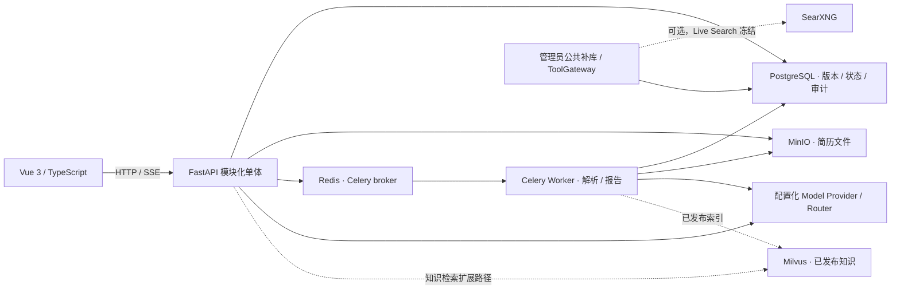

# Interview Agent Platform

面向秋招的多 Agent 求职与模拟面试平台。

已有简历上传、候选人画像、证据支持的岗位推荐、动态模拟面试、回答评价、
面试复盘报告和用户批准的长期成长记录。主要功能已冻结，工程交付记录见
[交付验收](docs/27_engineering_delivery.md)，[文档索引](docs/README.md)。

当前增量状态：V1.4 管理员职业资料采集接入独立 DeepSeek Search/Fetch Provider，
沿用共享 Source/Snapshot、Research 和审核发布。需要单独配置
`DEEPSEEK_WEB_API_KEY`（不能复用方舟模型 Key）。代码与 Replay 验收不等同于真实
在线采集验收；当前凭证阻塞与完整记录见 [V1.4 交付](docs/46_deepseek_web_career_v1_4.md)。
旧 SearXNG 仍为独立冻结 Provider，不作为新采集入口的自动 fallback。

## 用户流程

上传简历 → Candidate Profile → 岗位推荐 / 用户指定岗位 → 模拟面试 →
回答评价 → Final Interview Report → Controlled Memory。

普通用户读取已发布公共数据，不触发实时抓取。面经原始采集、审核与发布属于管理侧。

## 六个 Agent 与确定性边界

| 角色 | 模型职责 | 程序职责 |
|---|---|---|
| Public Data Research Agent | 从已有 Snapshot 提取公共职业事实 | Evidence ID 校验、去重、来源与发布门槛 |
| Resume/Profile Agent | 提取简历支持的候选人事实 | 稳定 ResumeEvidence、技能状态向下收敛、版本与幂等 |
| Job Matching Agent | 对候选岗位解释与有限 rerank | Top-N、硬资格、Evidence Matrix、最终排名 |
| Interview Main Agent | 生成可追溯的问题与补问 | 固定上下文、预算与 SessionController 状态推进 |
| Answer Evaluation Agent | 本轮五维评价与下一步建议 | 1–5 量表校验、Answer/Evaluation 幂等、短事务 |
| Summary/Coach Agent | 汇总表现、练习计划、记忆建议 | 数据库统计、引用解析、报告 current 原子切换、审批 |

Agent 不自由互聊，以 Structured Artifact 交接。模型不得伪造证据、改变硬资格、
自行推进面试、重算均分或自动写长期 Memory。业务状态最终由确定性服务提交。

## 系统架构



PostgreSQL 为业务真相源；MinIO 保存材料，Worker 执行异步解析。
Milvus 仅存已发布可检索知识，不承载未审核 raw/candidate 内容。
etcd 是本地 Milvus 的依赖，不是另一个业务系统。
稳定 Replay Demo 只启动 PostgreSQL、Redis、MinIO 与 API/Worker/Web，不要求 SearXNG 或 Milvus。

## Evidence 与可靠性

- ResumeEvidence：程序从简历正文确定性生成，Agent 只能引用已有 ID。
- SourceSnapshot：实际 Fetch 的正文或明确标记 fixture；search snippet 不冒充正文。
- Claim / ClaimEvidence：公共事实与 Snapshot 的可追溯支持。
- Evidence Matrix：候选人侧材料与岗位版本/Requirement 对齐；NO_EVIDENCE 不是“不会”。
- Structured Output 最多一次 constrained repair；业务 validator 失败不能换模型刷成功。
- 幂等 key、状态机、不可变 Profile/JD 版本、Interview Snapshot pinning、防并发覆盖。
- SSE 结果在数据库提交后发送；Replay 支持可重复业务验收。

## Memory 的分层

Evaluation ≠ CandidateProfile；某场 PerformanceObservation ≠ 稳定长期事实。

MemoryProposal → 用户 approve / correct / reject → 既有 Career Memory。
批准/修正并批准为单事务，拒绝不写 Memory。
下一场面试一次性读取已批准 Memory 与近期 Observation，分别固定到 Snapshot，
当前场次不会随 Memory 后续变化漂移。

## Quick Start（Windows）

需要 Docker Desktop、Python 3.11+、uv、Node.js、pnpm；脚本不会自动安装软件。

```powershell
Copy-Item .env.example .env
# 编辑 .env：配置本地 PostgreSQL/MinIO 凭据、JWT、模型 endpoint / API key。
# POSTGRES_PASSWORD 必须与 DATABASE_URL 密码一致。
# 已有数据库 volume 不会因更改初始化变量而修改原账号密码。
cd apps/api
uv sync --frozen
cd ../worker
uv sync --frozen
cd ../web
pnpm install --frozen-lockfile
cd ../..
powershell -NoProfile -ExecutionPolicy Bypass -File scripts/check-environment.ps1
powershell -NoProfile -ExecutionPolicy Bypass -File scripts/start-interview-platform.ps1
```

普通本地：Web http://127.0.0.1:5173，API http://127.0.0.1:8000/docs。
启动前确认 migration head 为 0024 并升级当前库；失败立即停止后续启动，不建/删正式库。
新环境须先按现有方式创建数据库/账号；默认 Compose 仅初始化其数据库。

```powershell
# 专用 DEMO 库；fixture 与 Replay 模型，不是 Live Search 或真实模型验收
powershell -NoProfile -ExecutionPolicy Bypass -File scripts/start-interview-platform.ps1 -Demo
powershell -NoProfile -ExecutionPolicy Bypass -File scripts/status-interview-platform.ps1 -Demo
powershell -NoProfile -ExecutionPolicy Bypass -File scripts/stop-interview-platform.ps1 -Demo
# 显式停止本项目 Docker 基础设施；不删容器和 volume
powershell -NoProfile -ExecutionPolicy Bypass -File scripts/stop-interview-platform.ps1 -Demo -StopInfrastructure
```

DEMO：Web http://127.0.0.1:5174，API 8013，独立数据库
`interview_agent_m6_f3_ux_demo`，独立 Redis DB 13/14 与 Worker queue。
复用既有 fixture，存在时不重复 seed；详细账号/步骤见 [Demo Guide](docs/demo-guide.md)。
Demo Worker 只用于运行与 ping 验证；已有 fixture 简历用于展示，不宣称 Demo 上传后真实模型生成画像。
普通模式才支持当前真实上传/解析链路。

旧 `start-dev.bat / stop-dev.bat / status-dev.bat` 仅转发对应 PowerShell。
PID 记录在 `.runtime/platform/pids`，stdout/stderr 分别在 `.runtime/platform/logs`。
脚本只管理自身 PID + 创建时间 + 可执行文件 + 命令行匹配的进程及其后代，不抢占端口。
默认 stop 保留基础设施；SearXNG 仅在明确 `-WithSearch` 时启动，不执行搜索验收。
外部依赖可用 `-SkipInfrastructure`，不会安装或替换服务。

## 配置与安全

真实模型配置：Primary `deepseek-v4-pro-ga-260813`，
availability-only fallback `doubao-seed-2-1-turbo-260628`。
各角色复用现有 route 配置，不在 Agent 中硬编码模型。

`APP_ENV=development/test` 允许明确开发 JWT。
其他环境拒绝缺失、开发默认、明显 placeholder 或弱 JWT，且不会随机生成密钥。
生产需自行提供至少 32 字符的强 secret；不要用 README、测试文件或模板中的示例值。

Compose 是本地开发基础设施，公开端口与无认证 Redis **不适合直接暴露公网**。
`.env`、dump、运行日志/PID、用户简历不入 Git。
真实凭据由使用者本地配置；不打印 `docker compose config` 的含凭据展开结果。

## Real / Replay 验收边界

- F2 Attempt 2：六 Agent 使用真实 DeepSeek 成功，未 fallback；详情及 usage 见
  [真实模型验收](docs/25_real_model_acceptance.md)。旧失败 Attempt 保留。
- Replay：M1–M6 集成与两场 Memory Snapshot / 三岗位资格边界，以及浏览器主流程已验收。
- Live Search：第三方 CAPTCHA/rate limit 限制仍存在，不作为稳定 Demo 路径；没有“全部 Live E2E”承诺。
- F3/F4 浏览器展示为明确 DEMO/Replay，不等同于 F2 的真实推理验收。

## Tests

F3 基线：backend 201 passed、frontend 11/11。F4 新增 JWT 与安全脚本检查，最终数字见交付记录。

```powershell
# 必须使用新建独立回归库；会创建下述指定前缀库，不使用/清空正式库
cd apps/api
uv run --frozen --no-sync python ../../scripts/run-regression.py --database interview_agent_f4_regression_unique_attempt
cd ../web
node --test tests/*.test.mjs
pnpm build
cd ../..
git diff --check
```

同名回归库存在时脚本拒绝复用；migration downgrade 需要空库前提，保留所有失败尝试。
正式库 revision 0024、备份与旧数据完整性单独只读检查，不对其运行 migration 测试。

## Known Limitations

- Live Search 上游稳定性有限，继续冻结。
- OCR/ASR provider 留有接口，但并非所有扫描件/媒体均可可靠解析；page/offset 不可靠时保持未知。
- 学历/专业/毕业年缺少可靠结构化证据时资格保持 UNKNOWN，不能让模型猜测。
- 部分 Token budget 使用保守 UTF-8 byte 策略，不是精确 tokenizer 预算。
- 本地 Compose、开发 JWT、HTTP 与单 Worker 配置不等于生产部署安全验收。
- 没有新建 Job/Research audit 管理页面；不宣称已有完整生产管理系统。
- sample_docs 明确为合成材料，不能作为实际用户履历或项目成果认证。

功能阶段已冻结；F4 完成后停止新增 Agent 和主要业务功能，不进入 F5。
